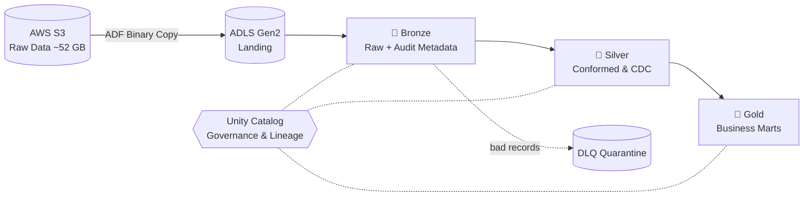

# 🏗️ Enterprise E-Commerce Lakehouse on Azure Databricks

> An end-to-end modern data platform that migrates an AWS-based e-commerce workload to Microsoft Azure using the **Medallion Architecture**, **Unity Catalog**, **Delta Lake**, and **Azure Data Factory**.


---

## 📑 Table of Contents

- [Overview](#-overview)
- [Architecture](#-architecture)
- [Tech Stack](#-tech-stack)
- [Repository Structure](#-repository-structure)
- [Layer-by-Layer Breakdown](#-layer-by-layer-breakdown)
- [Key Engineering Highlights](#-key-engineering-highlights)
- [Getting Started](#-getting-started)
- [Author](#-author)

---

## 🔎 Overview

This project simulates a real-world migration of **~52 GB** of raw e-commerce operational data from **AWS S3** to **Azure Data Lake Storage Gen2**, then models it into analytics-ready tables on **Azure Databricks (Serverless)**.

It covers the full data engineering lifecycle: cloud-to-cloud ingestion, governed storage, audit-ready bronze tables, conformed silver models (SCD2, CDC, deduplication), and business-facing gold marts.

---

## 🧭 Architecture



| Stage | Description |
|---|---|
| **Ingestion** | Azure Data Factory cloud-to-cloud binary copy from S3 → ADLS Gen2 |
| **Bronze** | Delta tables enriched with audit headers for lineage and dedup |
| **Silver** | SCD Type 2 dimensions, fuzzy-match dedup, CDC `MERGE INTO` upserts |
| **Gold** | RFM segmentation, fulfillment SLA analytics, financial reconciliation |
| **Governance** | Unity Catalog RBAC, external locations, lineage tracking |

---

## 🧰 Tech Stack

| Category | Tools |
|---|---|
| **Compute** | Azure Databricks (Serverless), Apache Spark / PySpark, Spark SQL |
| **Storage** | ADLS Gen2, Delta Lake |
| **Ingestion** | Azure Data Factory (ADF) |
| **Governance** | Unity Catalog, Access Connectors, Managed Identity |
| **Orchestration** | Databricks Workflows |
| **Languages** | Python, SQL |

---

## 📂 Repository Structure

```text
azure-databricks-ecommerce-lakehouse/
├── README.md
├── architecture_diagram.png
├── adf/
│   └── pipelines/
│       └── pl_copy_s3_to_adls_dataset1.json
├── notebooks/
│   ├── 00_setup_and_governance/
│   │   ├── 00_storage_credentials_and_locations.py
│   │   └── 01_unity_catalog_metastore_setup.py
│   ├── 01_bronze/
│   │   ├── 01_raw_batch_ingestion.py
│   │   └── 02_dead_letter_queue_audit.py
│   ├── 02_silver/
│   │   ├── 01_dim_customers_scd2.py
│   │   ├── 02_dim_products_catalog.py
│   │   ├── 03_fct_orders_fulfillment.py
│   │   └── 04_fct_financial_ledger_cdc.py
│   ├── 03_gold/
│   │   ├── 01_customer_lifetime_value_rfm.py
│   │   ├── 02_fulfillment_logistics_sla.py
│   │   └── 03_daily_financial_reconciliation.py
│   └── 04_orchestration/
│       └── databricks_workflow_job_definition.json
└── tests/
    └── data_quality_expectations.py
```

---

## 🧱 Layer-by-Layer Breakdown

### ⚙️ Layer 0 — Setup & Governance

| Notebook | Responsibility |
|---|---|
| `00_storage_credentials_and_locations` | Configures Azure Managed Identity with Unity Catalog Access Connectors and registers External Locations for landing, bronze, silver, and gold on ADLS Gen2 |
| `01_unity_catalog_metastore_setup` | Creates `bronze`, `silver`, and `gold` schemas; configures row/column-level access control tags and auditing defaults |

### 🥉 Layer 1 — Bronze (Raw Append & Audit Metadata)

| Notebook | Responsibility |
|---|---|
| `01_raw_batch_ingestion` | Reads multi-file batches from `landing/raw_feeds/`, dynamically maps domain files to target Delta tables, and injects audit headers |
| `02_dead_letter_queue_audit` | Isolates corrupted CSV lines (malformed commas, schema drift) into `bronze.dlq_quarantine` |

**Audit columns added to every bronze table**

| Column | Purpose |
|---|---|
| `_ingested_at` | UTC timestamp of arrival |
| `_source_file_name` | Original file origin (from `_metadata.file_name`) |
| `_batch_id` | UUID for end-to-end lineage tracing |
| `_row_hash` | SHA-256 payload fingerprint for deduplication |

### 🥈 Layer 2 — Silver (Conformed, Normalized & CDC-Enriched)

| Notebook | Responsibility |
|---|---|
| `01_dim_customers_scd2` | **SCD Type 2** using window functions: `LEAD()` over `usr_addr_change_date` to derive `valid_to`, a `9999-12-31` sentinel for active rows, and an `is_current` flag |
| `02_dim_products_catalog` | Consolidates first-party and third-party vendor feeds, resolves brand duplicates with **Levenshtein distance**, and pivots EAV rows from `products_attribute` into structured columns |
| `03_fct_orders_fulfillment` | Joins orders, order items, shipments, and shipment items at order-line grain; computes order-to-shipment SLA latency and dispatch delay |
| `04_fct_financial_ledger_cdc` | Applies `payment_txn_cdc` change logs via Delta `MERGE INTO`, joins gateway settlements and returns to build an auditable **double-entry ledger** |

### 🥇 Layer 3 — Gold (Business Reporting)

| Notebook | Business Question Answered |
|---|---|
| `01_customer_lifetime_value_rfm` | Who are our best customers? (Recency, Frequency, Monetary segmentation) |
| `02_fulfillment_logistics_sla` | Which carriers and fulfillment centers are underperforming? (on-time delivery rate, bottlenecks) |
| `03_daily_financial_reconciliation` | Do revenue, discounts, fees, and refunds reconcile to the ledger daily? |

---

## ✨ Key Engineering Highlights

- **Cloud-to-cloud migration** with ADF binary copy (S3 → ADLS Gen2), no local hops
- **Full lineage** via `_batch_id`, `_source_file_name`, and Unity Catalog lineage
- **Dead-letter queue** pattern so bad records never block the pipeline
- **SCD Type 2** built with pure Spark SQL window functions
- **Fuzzy deduplication** of third-party catalogs using Levenshtein distance
- **Idempotent CDC** upserts with Delta `MERGE INTO`
- **Governed by design**: external locations, managed identity, and RBAC from day one

---

## 🚀 Getting Started

1. **Provision** an Azure Databricks workspace with Unity Catalog enabled and an ADLS Gen2 storage account.
2. **Deploy** the ADF pipeline in [`adf/pipelines/`](adf/pipelines/) to copy source data from S3 to the landing zone.
3. **Run setup notebooks** in `notebooks/00_setup_and_governance/` to create credentials, external locations, and schemas.
4. **Execute** bronze → silver → gold notebooks in order, or import the job from `notebooks/04_orchestration/databricks_workflow_job_definition.json`.
5. **Validate** outputs with [`tests/data_quality_expectations.py`](tests/data_quality_expectations.py).

---

## 👤 Author

**Nikhil Choudhary**
Data Engineer · [GitHub](https://github.com/nikhilchoudhary28)

⭐ If you found this project useful, consider giving it a star!
