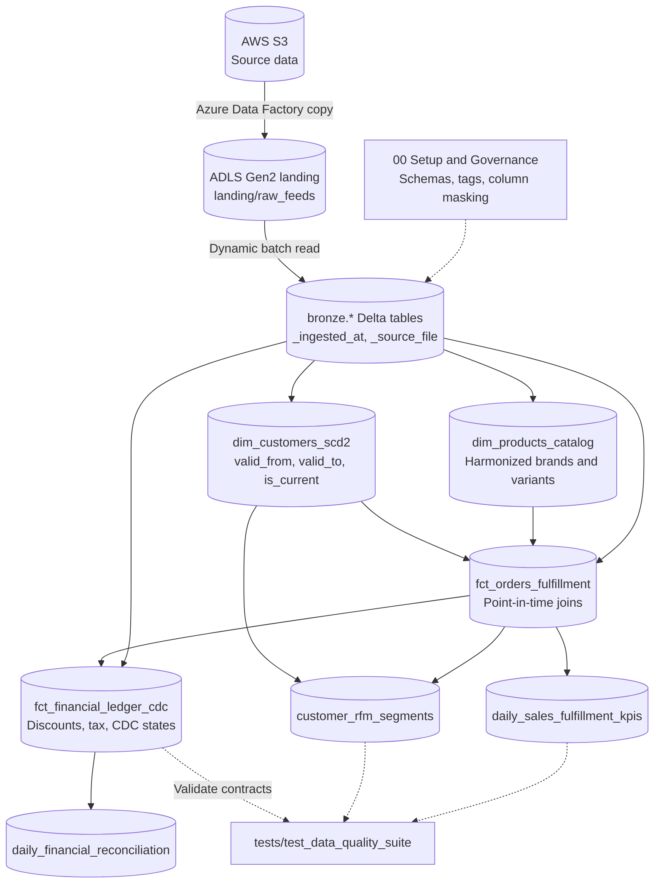

# Enterprise E-Commerce Lakehouse on Azure Databricks

> An end-to-end data lakehouse for e-commerce operational data on Microsoft Azure, built with the **Medallion Architecture**, **Unity Catalog**, **Delta Lake**, and **PySpark on Serverless Compute**.


---

## Table of Contents

- [Overview](#overview)
- [Architecture](#architecture)
- [Tech Stack](#tech-stack)
- [Repository Structure](#repository-structure)
- [Layer-by-Layer Breakdown](#layer-by-layer-breakdown)
- [Automated Testing and Quality Suite](#automated-testing-and-quality-suite)
- [Key Engineering Patterns](#key-engineering-patterns)
- [Getting Started](#getting-started)
- [Author](#author)

---

## Overview

This project implements a governed lakehouse on **Azure Databricks Serverless Compute** with full **Unity Catalog** controls.

Multi-domain e-commerce data lands in **Azure Data Lake Storage Gen2** and flows through three layers:

| Layer | What it delivers |
|---|---|
| **Bronze** | Automated batch ingestion into Delta tables with audit metadata |
| **Silver** | Conformed dimensions and facts: SCD Type 2 with point-in-time joins, catalog harmonization, and a financial ledger with CDC states |
| **Gold** | Business marts for RFM customer segmentation, sales and fulfillment KPIs, and daily financial reconciliation |

A dedicated test notebook validates data contracts across all layers after each run.

---

## Architecture



---

## Tech Stack

| Category | Tools and Services |
|---|---|
| **Cloud platform** | Microsoft Azure |
| **Compute** | Azure Databricks (Serverless Compute) |
| **Storage** | Azure Data Lake Storage Gen2, Delta Lake |
| **Catalog and governance** | Unity Catalog (managed tables, tags, schema comments, column masking) |
| **Processing** | Apache Spark, PySpark, Delta Lake APIs, Spark SQL |
| **Data quality** | Custom PySpark test suite for data contracts and regression checks |
| **Version control** | Git, GitHub |

---

## Repository Structure

```text
azure-databricks-ecommerce-lakehouse/
├── README.md
├── 00_Setup_and_Governance/
│   └── 01_unity_catalog_governance_setup.ipynb
├── 01_Bronze/
│   └── 01_raw_batch_ingestion.ipynb
├── 02_Silver/
│   ├── 01_dim_customers_scd2.ipynb
│   ├── 02_dim_products_catalog.ipynb
│   ├── 03_fct_orders_fulfillment.ipynb
│   └── 04_fct_financial_ledger_cdc.ipynb
├── 03_Gold/
│   ├── 01_gold_customer_rfm_segments.ipynb
│   ├── 02_gold_daily_sales_fulfillment_kpis.ipynb
│   └── 03_daily_financial_reconciliation.ipynb
└── tests/
    └── test_data_quality_suite.ipynb
```

---

## Layer-by-Layer Breakdown

### 00. Setup and Data Governance

**Notebook:** `00_Setup_and_Governance/01_unity_catalog_governance_setup.ipynb`

- Creates the `bronze`, `silver`, and `gold` schemas in the active Unity Catalog metastore.
- Adds metadata comments describing each tier, its intended consumers, and its lifecycle.
- Applies compliance tags such as `tier`, `lifecycle`, `contains_raw_pii`, and `scd_pattern`.
- Enforces column-level PII protection with a SQL masking function (`silver.mask_email`) so only authorized roles see raw customer emails.

### 01. Bronze Layer (Raw Ingestion)

**Notebook:** `01_Bronze/01_raw_batch_ingestion.ipynb`

- Traverses the ADLS Gen2 landing container and groups multi-file entity domains (customers, items, orders, addresses) into target tables.
- Adds audit metadata to every record:

| Column | Description |
|---|---|
| `_ingested_at` | UTC timestamp of arrival |
| `_source_file` | Source file path, captured from `_metadata.file_path` |

- Writes all raw feeds as managed Delta tables under `bronze.*`.

### 02. Silver Layer (Conformed Dimensions and Facts)

| Notebook | Target table | Engineering techniques |
|---|---|---|
| `01_dim_customers_scd2` | `silver.dim_customers_scd2` | **SCD Type 2** address history per user. Window functions over change timestamps produce `valid_from` and `valid_to`, with a `9999-12-31` sentinel and an `is_current` flag for active rows. Deterministic surrogate key `customer_sk` is a SHA-256 hash of `usr_id` and `valid_from`. |
| `02_dim_products_catalog` | `silver.dim_products_catalog` | Harmonizes first-party and third-party vendor catalogs. Resolves schema differences across product IDs, brands, and variants, standardizes unit prices, removes duplicate listings, and assigns hash-based `product_sk` keys. |
| `03_fct_orders_fulfillment` | `silver.fct_orders_fulfillment` | Joins cart line items with fulfillment feeds. Uses **point-in-time SCD2 lookups** (`order_date BETWEEN valid_from AND valid_to`) to capture each customer's location at purchase time. Builds a composite `fact_order_sk` and applies `ZORDER BY (order_date, fulfillment_status)`. |
| `04_fct_financial_ledger_cdc` | `silver.fct_financial_ledger_cdc` | Tracks payment lifecycles (`AUTHORIZED`, `SETTLED`, `REFUNDED`). Applies coupon rates, computes net settled amount (gross - discount + tax), and records CDC operation codes (`INSERT`, `UPDATE`) with deterministic `ledger_sk` hashes. |

### 03. Gold Layer (Business Marts and KPIs)

| Notebook | Target table | Business value |
|---|---|---|
| `01_gold_customer_rfm_segments` | `gold.customer_rfm_segments` | Computes Recency, Frequency, and Monetary value per customer, ranks each with `NTILE` quartiles, and assigns marketing cohorts: Champions, Loyal Customers, At Risk, and Lost / Hibernating. |
| `02_gold_daily_sales_fulfillment_kpis` | `gold.daily_sales_fulfillment_kpis` | Daily executive KPIs: order count, units sold, gross revenue, and unique buyers by city, state, and product category. |
| `03_daily_financial_reconciliation` | `gold.daily_financial_reconciliation` | Daily reconciliation of gross merchandise value (GMV), discounts, sales tax, refunds, and net cash flow. |

---

## Automated Testing and Quality Suite

`tests/test_data_quality_suite.ipynb` runs post-pipeline assertions across the lakehouse:

- Row-count checks on bronze tables
- Surrogate key uniqueness in Silver dimensions and facts
- SCD2 interval validity (`valid_to >= valid_from`) and `is_current` consistency
- Non-negative unit prices and non-null order identifiers
- Gold table completeness (RFM segments and daily KPIs populated)

Sample output:

```text
==================================================
[Layer: 01_Bronze]
  [PASS] bronze.user_addr_scd2 row count check
  [PASS] bronze.cart_items row count check
  [PASS] bronze.catalog_data row count check

[Layer: 02_Silver - dim_customers_scd2]
  [PASS] Customer Surrogate Key Uniqueness (0 duplicates)
  [PASS] SCD2 Interval Validity (valid_to >= valid_from)
  [PASS] is_current Flag Logic (active record consistency)

[Layer: 02_Silver - dim_products_catalog]
  [PASS] Product Surrogate Key Uniqueness
  [PASS] Non-Negative Unit Prices

[Layer: 02_Silver - fct_orders_fulfillment]
  [PASS] Fact Order Key Uniqueness
  [PASS] Non-Null Order Identifiers

[Layer: 03_Gold]
  [PASS] RFM Customer Segment Completeness
  [PASS] Daily Sales KPI Population
==================================================
Test Summary: 11 PASSED, 0 FAILED
```

---

## Key Engineering Patterns

- **Serverless + Unity Catalog managed tables:** all tables are managed Delta tables, which avoids storage-key access limits on serverless compute.
- **Deterministic surrogate keys:** SHA-256 hashes over natural keys and validity timestamps (`customer_sk`, `product_sk`, `fact_order_sk`, `ledger_sk`) avoid auto-increment bottlenecks in a distributed engine.
- **Point-in-time dimension lookups:** date-range joins keep historical reports accurate when customers change address.
- **Physical layout optimization:** Silver and Gold models run `OPTIMIZE ... ZORDER BY` on common filter and join columns for better file pruning.
- **Governance as code:** tags and dynamic column masking are applied programmatically so privacy controls are reproducible.

---

## Getting Started

### Prerequisites

- An Azure subscription with an Azure Databricks workspace
- A Unity Catalog metastore assigned to the workspace
- An ADLS Gen2 storage account with raw data staged under `landing/raw_feeds/`

### Run the pipeline

1. Clone the repository into your Databricks workspace (Workspace → Repos, or via Git folders):

   ```bash
   git clone https://github.com/nikhilchoudhary28/azure-databricks-ecommerce-lakehouse.git
   ```

2. Attach each notebook to **Serverless Compute**.
3. Run the notebooks in this order:
   1. `00_Setup_and_Governance/01_unity_catalog_governance_setup.ipynb`
   2. `01_Bronze/01_raw_batch_ingestion.ipynb`
   3. `02_Silver/` notebooks `01` through `04`
   4. `03_Gold/` notebooks `01` through `03`
4. Run `tests/test_data_quality_suite.ipynb` to verify the data contracts.

---

## Author

**Nikhil Choudhary**
Data Engineer · [GitHub](https://github.com/nikhilchoudhary28) · [LinkedIn](https://linkedin.com/in/nikhil-choudhary99)